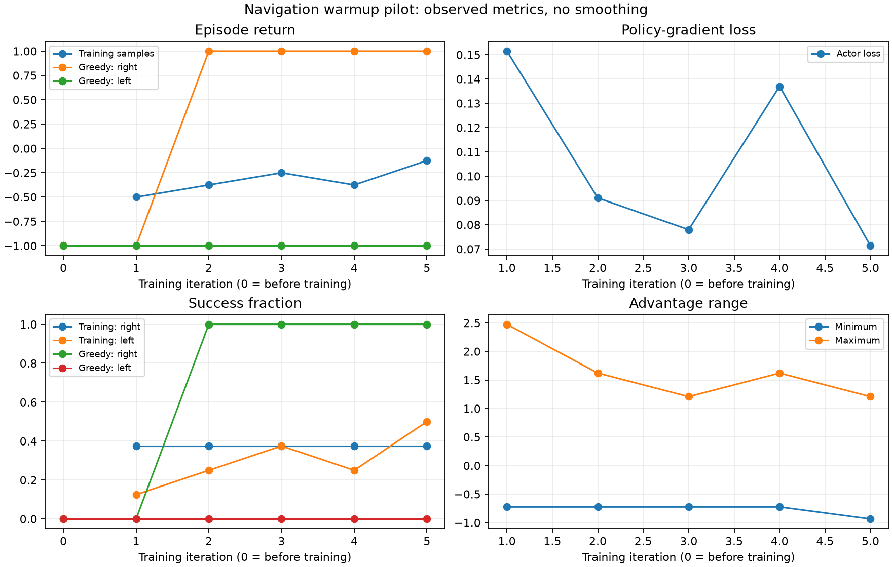

# Taking a Detour to Win — Strategic Blocking in LLM Agents

- **Team:** YC Qiu and Prakeerth Prasad
- **Course:** Agentic AI
- **Status:** Five-update balanced LoRA/GRPO pilot and matched evaluation completed. Navigation success improved on the two fixed training maps; strategic blocking remains unproven.

Can a reinforcement-learning-trained LLM agent learn when it is worth leaving its own shortest route to block an opponent, then returning to finish first? This pilot studies both the cost of a blocking detour and the timing of obstacle placement. Only A is trained; B follows a fixed shortest-path policy.

## Latest verified milestone

The balanced pilot trained Qwen2.5-0.5B-Instruct with LoRA/GRPO for five updates,
using eight samples per direction per update. Both training groups had mixed
success/failure rewards in every iteration. The final checkpoint and automatic
336-tensor adapter export were saved and verified.

| Fixed map | Original base | Balanced adapter | Difference |
| --- | ---: | ---: | ---: |
| One-step right | 17/50 (34%) | 47/50 (94%) | +60 percentage points |
| One-step left | 1/50 (2%) | 32/50 (64%) | +62 percentage points |
| Short blocking | 1/50 (2%) | 0/50 (0%) | -2 percentage points |

These are matched sampled evaluations of the exported adapter on the same cached
base model, not held-out generalization or exact FP32 checkpoint replay. All 300
trajectories were replayed against the environment. Only one training seed was
tested. Overall invalid-action rates remain higher for the adapter: 67/325 (20.6%)
versus 42/364 (11.5%) for the base. The balanced run used twice the training episode
budget of the earlier right-only pilot, so that comparison does not isolate the
effect of curriculum composition.



See [the milestone analysis](docs/balanced-pilot-results.md),
[curated metrics](docs/balanced-pilot-results.json), and
[evaluation instructions](CHECKPOINT_EVALUATION.md).

## Quick start

Run inside this directory with Python 3.10+ (standard library only):

```powershell
python demo.py
python demo.py --trace episodes.json
python -m unittest test_maze test_ragen_maze -v
```

## Reproductions

The 11-row, 14-column main map was transcribed from the tiles on slides 3–4 of the [project presentation](https://docs.google.com/presentation/d/10VW3zM-tbud9UVQoxef7KA3oxMRh8gwywWqiOLcqfa0/edit). Coordinates count from zero, in (row, column) order.

| Map and A policy | Winner | Actual A / B actions | Full A / B actions |
| --- | --- | --- | --- |
| Slides 3–4, direct | B | 8 / 9 | 13 / 9 |
| Slides 3–4, block on arrival | A | 22 / 22 | 22 / 25 |
| Slide 7, block now | A | 6 / 6 | 6 / 12 |
| Slide 7, wait three turns | A | 9 / 9 | 9 / 18 |
| Modified map, direct | A | 6 / 6 | 6 / 9 |
| Modified map, block on arrival | B | 12 / 13 | 15 / 13 |

Actual counts stop at the first arrival. Full counts add the shortest remaining distance from the terminal state, assuming direct movement thereafter.

- **Main race.** The direct shortest paths are disjoint. A moves right twice and down twice, from (3,5) to (5,7). On round 5 B reaches (5,5) and A blocks (5,6). B has already spent 5 actions and now has 20 left. A takes 4 steps back and follows its original 13-step route. At round 22 A wins with B still 3 steps away.
- **Timing experiment.** Slide 7 uses its own map and omits A's goal. Both runs use the same added A goal at the upper-left open cell. B starts at the fork (1,0). At placement it is either 1 or 4 steps inside the corridor. Three extra steps in and three back out explain the six-step difference. Both policies win with this choice of A goal. The slide supports a comparison of travel costs.
- **Costly-detour control.** This authored variant moves A's goal to (1,9) and opens (6,3). A can now win in 6 actions by moving directly. Blocking still delays B from 9 to 13 total actions, but A would need 15.

## Environment and traces

`maze.py` contains the generic rules. B moves first each round using BFS from its current position, breaking shortest-path ties in up, right, down, left order. Runners can share or cross a tile. Only the permanent obstacle affects movement. A may place it once, on an orthogonally adjacent open cell, excluding either goal and B's current cell. Both runners must still have a path from their current positions to their respective goals. An invalid action raises an error before consuming A's turn.

At an A decision point call `race.observe()` after `race.advance_b()`, then apply one legal string with `race.act(action)`. If B reaches its goal, the round stops before A acts. The default cap is 100 complete rounds and arrival on the last round takes precedence over timeout. Terminal reward from A's perspective is +1 for an A win, −1 for a B win, and 0 for timeout. Intermediate rewards are zero.

`episodes.json` contains all six executed traces. Each round records B's move, A's full observation after B moves, the scripted action, the resulting map, the outcome and the reward. The map uses `#` for walls, `.` for open cells, `A/B` for runners, `a/b` for goals, `X` for the obstacle and `*` for shared occupancy. Goal coordinates are always available even when a runner covers the goal marker. The final B-only turn has no A decision or action.

## RAGEN integration

`ragen_maze.py` exposes the race as `StrategicBlockingEnv`, with `slides`, `costly`, and five small curriculum layouts. Reset advances B before presenting A's first observation. Each step executes A's action and advances B again unless the race has ended. The adapter uses a 32-round limit.

The native simulator and the training adapter handle invalid actions differently:

- The native simulator rejects an illegal action without changing the state.
- The adapter converts a parsed but illegal action into `wait`, consumes the turn, and reports `action_is_valid=False`.
- RAGEN may reject a malformed model response before calling the adapter. These manager-level failures must be tracked separately.

The tested LLM response format is one action inside `<answer>...</answer>`, such as `<answer>move right</answer>`. Observations include the full map, both positions and goals, available legal actions, the round number, and obstacle status. Environment rewards remain win `+1`, loss `-1`, and timeout `0`, with no intermediate reward or format penalty.

See [RAGEN.md](RAGEN.md) for environment registration and [the local training workflow](docs/local-training.md) for the packaged launcher, compatibility patches, and preflight checks. `scripts/run_ragen.sh` generates the reduced-memory run configuration from `strategic_blocking.yaml`. The packaged entry point completed a full GPU rerun on November 8, 2026. A clean installation remains unverified. See [A1 and A2 validation](docs/a1-a2-validation.md) for adapter recovery, reload checks, and limitations.

## Verified progress

### Environment and scripted policies

- Implemented the race rules, deterministic BFS opponent, observation rendering, and episode traces.
- Reproduced the slide example: direct movement loses, while the scripted blocking detour wins.
- Verified the timing example and a control in which taking the detour changes an A win into a loss.
- Passed 10 unit tests covering the core rules, reproductions, and adapter behavior, including turn-by-turn replay equivalence.

The winning blocking policies above are scripted demonstrations, not learned policies.

### Before-RL model evaluation

The untrained `Qwen/Qwen2.5-0.5B-Instruct` model completed one action-only evaluation episode on each of the two fixed race layouts. Both used greedy decoding and a two-turn context window.

| Evaluation layout | A actions before termination | Winner | Episode return |
| --- | --- | --- | --- |
| Slide reproduction | 8 | B | -1 |
| Costly-detour control | 8 | B | -1 |

In both episodes, A produced the sequence `wait, wait, move right, move right, move down, move up, move down, move up` and never placed an obstacle. These are two case studies, not a statistically meaningful win-rate estimate. Local episode records retain the observations, model responses, executed actions, and outcomes.

### First completed training smoke test

On November 7, 2026, run `train-one-F5JCCw3d` completed one training iteration and saved `global_step_1`. The local setup used Ubuntu under WSL2, an RTX 3070 with 8 GB VRAM, and approximately 12 GB of memory available to WSL.

| Setting | Value |
| --- | --- |
| Base model | Qwen/Qwen2.5-0.5B-Instruct |
| Training method | GRPO with LoRA; only A is trained |
| LoRA configuration | Rank 8, alpha 16, all linear layers |
| Learning rate | 0.0001 |
| Sampling | Temperature 1.0; two episodes per layout |
| Training data | Four episodes, expanded into 32 turn-level records |
| Micro-batch size | 1 |
| Trainer attention | SDPA, with gradient checkpointing |
| Memory handling | Parameter and optimizer CPU offload |
| Entropy coefficient | 0.001 |
| Training iterations | 1 |

| Recorded metric | Value |
| --- | --- |
| Successful episodes | 0 / 4 |
| Mean episode return | -1.0 |
| GRPO advantage, minimum / mean / maximum | 0.0 / 0.0 / 0.0 |
| Policy-gradient loss | 0.0 |
| Actor gradient norm | Approximately 0.01005 |
| Logged training-iteration duration | Approximately 391 seconds |

The main checkpoint contains 336 finite LoRA tensors. All 168 LoRA B tensors, which were initialized to zero, are nonzero after training. This confirms that adapter weights changed. CPU/GPU LoRA checks and two FSDP offload/update cycles also passed before the full run.

However, every sampled episode received the same loss reward, so the GRPO advantages and reward-driven policy-gradient loss were zero. The observed update is not evidence of reward-driven learning. Entropy regularization and optimizer effects can change weights despite a zero policy-gradient term; their individual contributions have not been isolated. This run verifies the training path; it does not establish that A learned strategic blocking.

## Packaged rerun and adapter recovery

Run train-one-QOwTZfVo completed one fresh training iteration using the packaged launcher. All 10 environment tests, CPU/GPU LoRA checks, and two FSDP offload cycles passed. Model and optimizer checkpoints were saved. The iteration took approximately 414.7 seconds; all four episodes lost, mean return was -1, and GRPO advantages and policy-gradient loss remained zero.

Separately, the original train-one-F5JCCw3d adapter was recovered using scripts/export_pilot_adapter.py. All 336 LoRA tensors were finite and matched the source exactly after saving. PEFT reload succeeded. Two fixed maze prompts produced exactly identical next-token logits before and after export with the checkpoint's frozen base weights and CPU float32 SDPA.

This verifies recovery and inference equivalence, not improved game performance. The generation smoke test did not follow the action format. These are two independent one-iteration runs, not a continuous two-iteration training run.

## Reward signal and continuous training

The initial sparse-reward probe found mixed outcomes only on the one-step right
fixture. Subsequent navigation pilots produced nonzero GRPO advantages. The
balanced five-update pilot now has mixed outcomes in both direction groups,
separate training/validation curves, saved checkpoints and post-training results.
The historical runbooks preserve the debugging sequence; the latest milestone
above supersedes their earlier pending-work statements.

## Known limitations and next steps

- **Strategic blocking is not learned yet.** The balanced adapter had zero wins
  on the short blocking fixture in 50 samples.
- **Generalization and replication remain pending.** Test longer routes, new
  layouts and independent training seeds. Reset seeds do not change fixed maps.
- **Action validity still needs improvement.** Higher navigation success does
  not imply better compliance with the legal-action protocol.
- **No explicit reasoning traces were collected.** Action-only case studies
  describe observed behavior, not the model's internal reasoning.
- **Independent Colab loading and clean installation remain pending.** The local
  patched RAGEN stack works but has recorded dependency conflicts. Original
  checkpoint PEFT reload was verified separately; current adapters ran in vLLM.
- **Additional environments, upstream contribution and final deliverables remain
  pending.** Extra maze layouts are variants of the same environment.

## Repository contents

| File | Purpose |
| --- | --- |
| scripts/export_pilot_adapter.py | Strict recovery of the original pilot LoRA tensors |
| scripts/verify_recovered_adapter.py | PEFT reload and CPU inference equivalence checks |
| scripts/run_a1_a2.sh | Evidence capture and both validation stages |
| test_export_pilot_adapter.py | Seven adapter-recovery guard tests |
| docs/a1-a2-validation.md | Milestone results and remaining work |
| docs/a1-a2-2026-11-08.json | Compact validation evidence |
| `maze.py` | Race rules, shortest paths, and observations |
| `demo.py` | Scripted policies and six reproducible cases |
| `episodes.json` | Full scripted demonstration traces |
| `test_maze.py` | Core-rule and reproduction tests |
| `ragen_maze.py` | RAGEN environment adapter |
| `test_ragen_maze.py` | Adapter tests |
| `strategic_blocking.yaml` | Initial RAGEN environment configuration |
| `RAGEN.md` | Registration and initial integration instructions |
| `scripts/run_ragen.sh` | Before-RL evaluation and bounded LoRA/GRPO training modes |
| `scripts/patch_ragen.py` | Guarded compatibility patches for an external RAGEN checkout |
| `scripts/check_ragen.py` | CPU/GPU LoRA and two-cycle FSDP offload preflight |
| `docs/local-training.md` | Local setup, commands, and validation scope |
| `docs/smoke-test-2026-11-07.json` | Curated metrics from the completed smoke test |

Generated runs and model checkpoints remain ignored local artifacts. Only curated result summaries and the selected learning-curve figure are versioned.

## Reproduce the current pilot

```bash
conda activate ragen
bash scripts/run_ragen.sh train-balanced
# Use the actual new training directory printed by the launcher.
python scripts/evaluate_checkpoint.py --training-run results/train/train-balanced-REPLACE_WITH_RUN_ID
```
