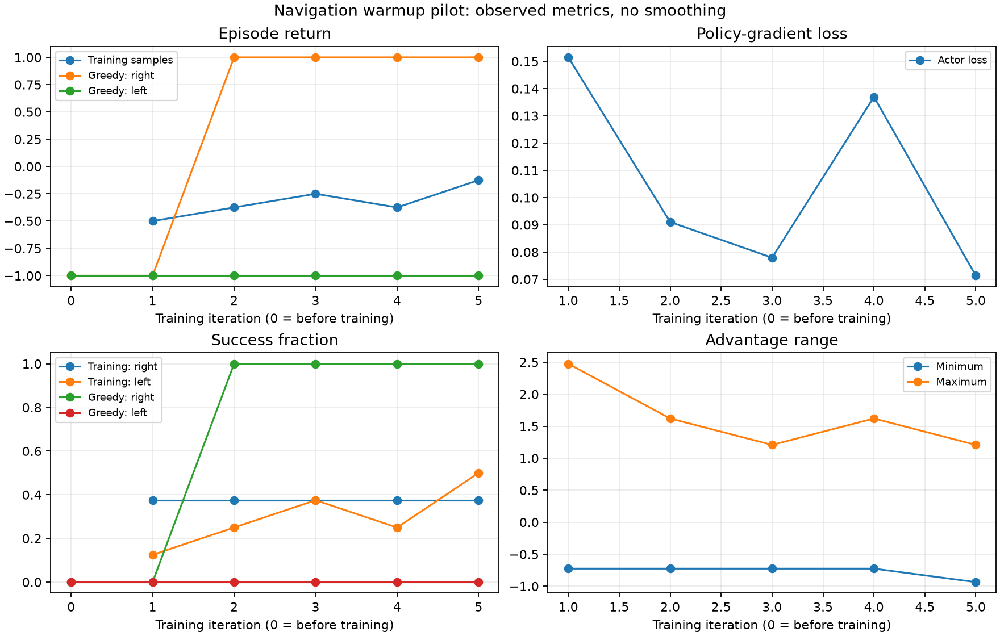

# Balanced navigation pilot: observed improvement and remaining limitations

The five-update balanced LoRA/GRPO run improved sampled navigation success on
both fixed training fixtures. It has not demonstrated strategic blocking or
generalization to unseen layouts.

## Experiment

- Model: Qwen2.5-0.5B-Instruct, rank-8 LoRA on all seven projection types.
- Training run: `train-balanced-jVnNYJRu`; final checkpoint: step 5.
- Training: eight samples per direction, two separate GRPO groups, five updates,
  learning rate 2e-5, terminal win/loss rewards and no entropy regularization.
- Evaluation: `paired-eval-o2ilk_u5`; 50 episodes per model/map; request seed
  20261108; temperature 1.0, top-p 1.0, top-k -1; matched initial prompt hashes.
- Comparison: original cached base versus the same base with the exported LoRA.
  This is not exact replay of the full FP32 training checkpoint.

## Matched sampled results

| Fixed fixture | Base success | Balanced adapter success | Adapter 95% Wilson interval |
| --- | ---: | ---: | ---: |
| warmup_right | 17/50 (34%) | 47/50 (94%) | 83.8%-97.9% |
| warmup_left | 1/50 (2%) | 32/50 (64%) | 50.1%-75.9% |
| blocking_short | 1/50 (2%) | 0/50 (0%) | 0.0%-7.1% |

There were no unresolved episodes. All 300 raw trajectories were replayed through
the environment; pre-action states, executed actions and final outcomes matched.
The large navigation gains support improvement on these two fixtures for this
trained adapter. A single training seed and a development evaluation suite do not
establish robust generalization. Wilson intervals describe rollout sampling
uncertainty, not variability between independently trained models.

## Training evidence

| Update | Right training success | Left training success |
| --- | ---: | ---: |
| 1 | 3/8 | 1/8 |
| 2 | 3/8 | 2/8 |
| 3 | 3/8 | 3/8 |
| 4 | 3/8 | 2/8 |
| 5 | 3/8 | 4/8 |

Every group had both wins and losses in each update. The right greedy validation
episode succeeded from update 2 onward; the left greedy episode continued to
fail. The left fixture triggered the five-low-validation early-stop rule after
the fifth update. Checkpoint saving completed before exit; the 80% progress-bar
display did not mean that only four actor updates occurred.



Training samples are collected before each update; greedy validation is separate.
The saved LoRA contains 336 finite tensors matching the final collected weights.
The evaluation's base audit found maximum FP32 drift of 5.96046448e-08 in LoRA
target weights. The declared 1e-7 absolute guard passed; exact equality was required
outside those targets. Both evaluated policies use identical cached base weights.

## Failures and comparison with the previous pilot

| Descriptive action metric | Base | Balanced adapter |
| --- | ---: | ---: |
| Invalid actions on warmup_right | 6/92 (6.5%) | 5/69 (7.2%) |
| Invalid actions on warmup_left | 15/100 (15.0%) | 20/84 (23.8%) |
| Invalid actions on blocking_short | 21/172 (12.2%) | 42/172 (24.4%) |
| Invalid actions across the suite | 42/364 (11.5%) | 67/325 (20.6%) |
| Blocking-short episodes with an executed obstacle | 24/50 | 14/50 |

Action-level denominators differ because episode lengths differ. These are
descriptive rates, not independent episode-level observations. Higher navigation
success has not solved action validity or strategic blocking.

The earlier right-only adapter scored 50%, 6% and 0% on the same three fixtures.
Its invalid-action rate was 82/334 (24.6%). The balanced run used 80 training
episodes versus 40 for the right-only run. Their comparison cannot isolate
curriculum composition from the increased sample budget. The repeated base
success counts matched the previous evaluation; this is a repeatability check,
not an independent new baseline sample.

The earlier base-model blocking success and its first-action counterfactual are
documented in [the first paired evaluation](a5-first-paired-evaluation.md). They
are useful observed-behavior cases, not evidence that RL learned blocking or that
an internal reasoning process was recovered. No explicit reasoning was requested.

## Next bounded experiment

Evaluate the saved balanced adapter on the two-step right and left fixtures and
the short blocking fixture using a different sampling seed. These are existing,
previously inspected development fixtures, not unseen test maps. This checks
transfer from one-step to longer navigation before investing in another training
run. Preserve all results, including failures.

```bash
python -u scripts/evaluate_checkpoint.py \
  --training-run results/train/train-balanced-jVnNYJRu \
  --layouts warmup_two_right warmup_two_left blocking_short \
  --seed 20261109 --episodes-per-layout 50
```

Further improvement claims require independent training seeds, a declared held-out
layout set, and a separate blocking curriculum. Additional maze layouts do not
count as an additional environment. Colab portability, another environment and
the final report/presentation remain separate work items.
