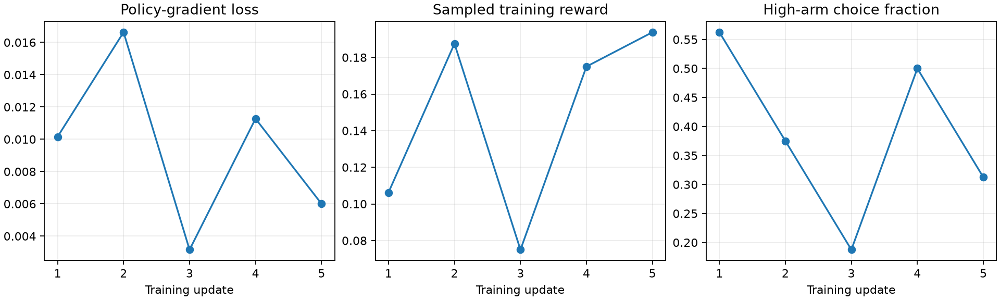

# Bandit pilot and environment-extension evidence

The native RAGEN Bandit pilot completed five recorded GRPO updates, all with nonzero advantages. The final adapter was exported and evaluated against the same cached base on 200 matched test instances with unseen arm names. Four additional scripted controls were evaluated on the same instances. This run establishes an additional working environment and comparison baselines; it does not demonstrate an improved Bandit policy.

## Evaluation

| Policy | High-arm choice | Mean observed reward | Mean expected reward | Invalid |
|---|---:|---:|---:|---:|
| Base | 50.0% | 0.1460 | 0.1710 | 8/200 |
| Adapter | 46.5% | 0.1255 | 0.16675 | 6/200 |
| Uniform random | 57.5% | 0.1225 | 0.18625 | 0/200 |
| First position | 54.5% | 0.1555 | 0.18175 | 0/200 |
| Always low | 0.0% | 0.1000 | 0.1000 | 0/200 |
| High oracle | 100.0% | 0.1900 | 0.2500 | 0/200 |

The high arm pays 1 with probability 0.25 and 0 otherwise; the low arm always pays 0.1. A high-arm choice is therefore the decision-quality metric, while realized reward also reflects payout randomness. Expected rewards in the table average the recorded choices and assign zero to invalid outputs. The uniform-random policy's population expected reward is 0.175; its finite sample selected the high arm 57.5% of the time. The oracle and always-low controls use privileged simulator labels.

Base high-arm choice was 100/200; the adapter achieved 93/200. No improvement is demonstrated. Invalid outputs decreased from 4% to 3%, which alone does not establish better decisions. One training seed and 200 test instances do not establish a reliable degradation claim either.

## Training curves and interpretation

All five policy-gradient losses and actual sampled training rewards are available in the run's PNG/PDF learning curves. Training reward rose from 0.10625 at update 1 to 0.19375 at update 5, while high-arm choice fell from 56.25% to 31.25%; intermediate values fluctuate. This illustrates why a higher observed payout is insufficient evidence of better decision quality in a stochastic environment. It does not identify the cause of the policy behavior.

The reward plot uses `critic/score/mean`. The installed native Bandit/manager combination logs zero for a separate raw-return chart because the environment omits that raw-reward field; that chart should not be used to describe actual training reward. Native instance-dependent seeding was preserved, so observations may differ within a GRPO group. This is a methodological limitation, not an established explanation of the null result.

## Extra-credit evidence

| Rubric item | Evidence available | Claim boundary |
|---|---|---|
| More environments / baselines | Native Bandit training, loss/reward curves, base/adapter evaluation, random and first-position baselines, privileged controls | Working additional environment and comparisons; Bandit improvement not shown |
| Adding a new environment to an existing repository | Strategic Blocking is registered in the installed RAGEN environment registry; four scripted adapter/native replay checks, deterministic reset, and invalid-action checks pass | Local RAGEN extension; no upstream acceptance or merge claimed |
| Other interesting RL findings | Reward noise versus decision quality; nonzero advantages do not guarantee improvement; Colab prompt sensitivity and layout-specific transfer are documented separately | Empirical findings with stated limits |

These are evidence for the requested bonus categories, not a guarantee of awarded points. Native Bandit already exists in RAGEN: the new-environment contribution is Strategic Blocking.

## Audit and remaining work

The CPU audit checked 400 model records and 800 unique control records, recomputed all six policy summaries, matched prompts and seeds across model evaluations, checked history rewards against matched control payouts, reparsed the five training updates, and verified the exported adapter file hash. Runtime registration and checkpoint verification records were inspected. GPU inference, the native stochastic simulator, and full checkpoint tensor verification were not repeated in this audit.

The learning-curve image was visually inspected. The report and slides still need to assemble the evidence: Strategic Blocking improvements on development layouts, the Colab wide-map success and mirror-map failures, this Bandit null result, and the environment integration. Actions-only generation does not supply an explicit thinking trace. Use observed action trajectories and interventions as case studies and state that limitation.
