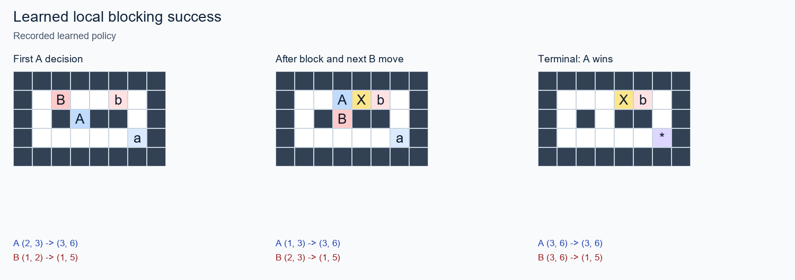
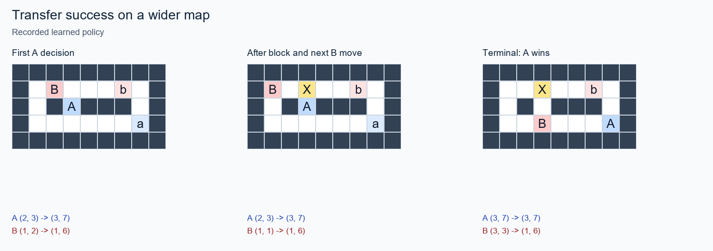
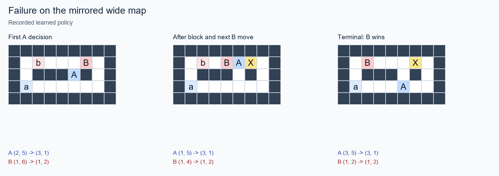
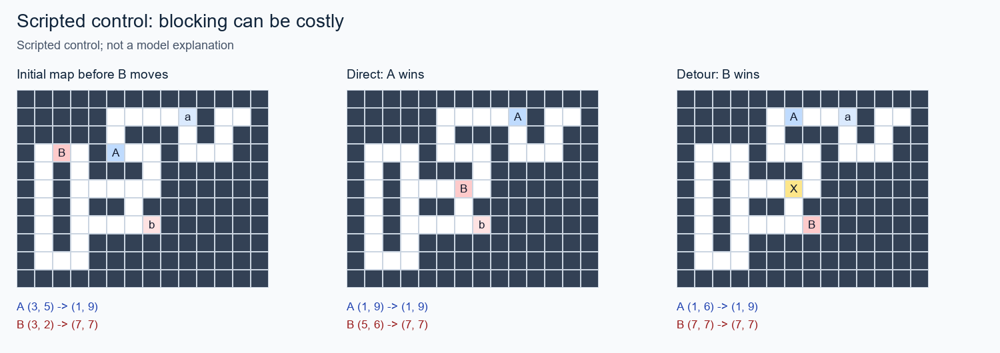

# Case studies: behavior and explanation limits

The four cases below are selected illustrations, not a representative success-rate estimate. Model outputs are quoted exactly; no explanations have been added to the original action-only responses. The separate rationale diagnostic elicits new brief explanations and cannot recover the cause of an earlier decision.

**Map legend:** A (blue) and B (red) are runners; a and b are their goals; X is the permanent obstacle; * means both runners occupy the same cell. Dark cells are walls. Coordinates are zero-based (row, column). Goals covered by a runner remain identified in the coordinate labels.

## Case 1: Learned local blocking success

**Type:** Recorded learned policy. **Selection:** First successful local blocking episode.



A enters the opponent corridor, blocks right, and returns toward its own goal. Blocking is functionally useful in this recorded trajectory; no explanation text was emitted. At the first block, B's remaining shortest-path distance changes from 2 to 8 steps, measured before B's next move. These distances exclude the action used to place the block.

Exact recorded model outputs, in order:

```text
<answer> move up </answer>
<answer>block right</answer>
<answer>move down</answer>
<answer>move down</answer>
<answer>move right</answer>
<answer>move right</answer>
<answer>move right</answer>
```

Replacing the first executed block with wait changes the outcome to a B win when later recorded actions remain fixed. This is an open-loop intervention, not a fresh policy rollout.

## Case 2: Transfer success on a wider map

**Type:** Recorded learned policy. **Selection:** First after-policy episode with the stated layout and outcome in original file order.



The final adapter blocks up immediately and reaches its goal. This illustrates the wide-map 40/50 result, not a generalization guarantee. At the first block, B's remaining shortest-path distance changes from 4 to 12 steps, measured before B's next move. These distances exclude the action used to place the block.

Exact recorded model outputs, in order:

```text
<answer>block up </answer>
<answer>move down</answer>
<answer>move right</answer>
<answer>move right</answer>
<answer>move right</answer>
<answer>move right</answer>
```

Replacing the first executed block with wait changes the outcome to a B win when later recorded actions remain fixed. This is an open-loop intervention, not a fresh policy rollout.

## Case 3: Failure on the mirrored wide map

**Type:** Recorded learned policy. **Selection:** First after-policy episode with the stated layout and outcome in original file order.



The model moves up, blocks right, and moves down twice before B wins. A legal block and a plausible-looking sequence are insufficient for success. We cannot infer whether the cause is spatial reasoning, action bias, or something else from this trace alone. At the first block, B's remaining shortest-path distance changes from 3 to 3 steps, measured before B's next move. These distances exclude the action used to place the block. The obstacle is behind B relative to its route toward the left-side goal and does not delay its shortest route at that decision. This is a factual action-effect mismatch with a hypothetical delay claim, not an explanation the model actually emitted.

Exact recorded model outputs, in order:

```text
<answer> move up </answer>
<answer>block right</answer>
<answer>move down</answer>
<answer>move down</answer>
```

## Case 4: Scripted control: blocking can be costly

**Type:** Scripted control; not a model explanation. **Selection:** Pre-existing authored costly-detour control.



The direct scripted policy wins in six A actions. The detour delays B but loses. This checks the task's trade-off; it does not establish that the trained model recognizes when to avoid blocking.

## What these cases do and do not show

- The two successes show useful obstacle placement in particular trajectories. They do not prove that the model explicitly planned a detour.
- The mirrored failure is evidence against reliable spatial transfer. Its legal actions do not identify the underlying cause of the failure.
- The costly-detour example shows the environment rewards selective blocking. It is scripted and cannot be used as evidence of learned selectivity.
- The original policies emitted actions only. The follow-up diagnostic compares newly elicited short explanations against legal actions, map facts, and action effects. It changes the prompt and is analyzed separately.

See [the diagnostic protocol and review rubric](rationale-diagnostic.md). Source hashes, exact observations and the selection rules are in [case-study-evidence.json](case-study-evidence.json).

## Completed explanation follow-up

The separate 72-request diagnostic is now complete and reviewed. See
[results and limitations](rationale-diagnostic-results.md) and
[real generated-output examples](rationale-diagnostic-examples.html). Its failures
are part of the case analysis; they do not change any original action-only scores.
