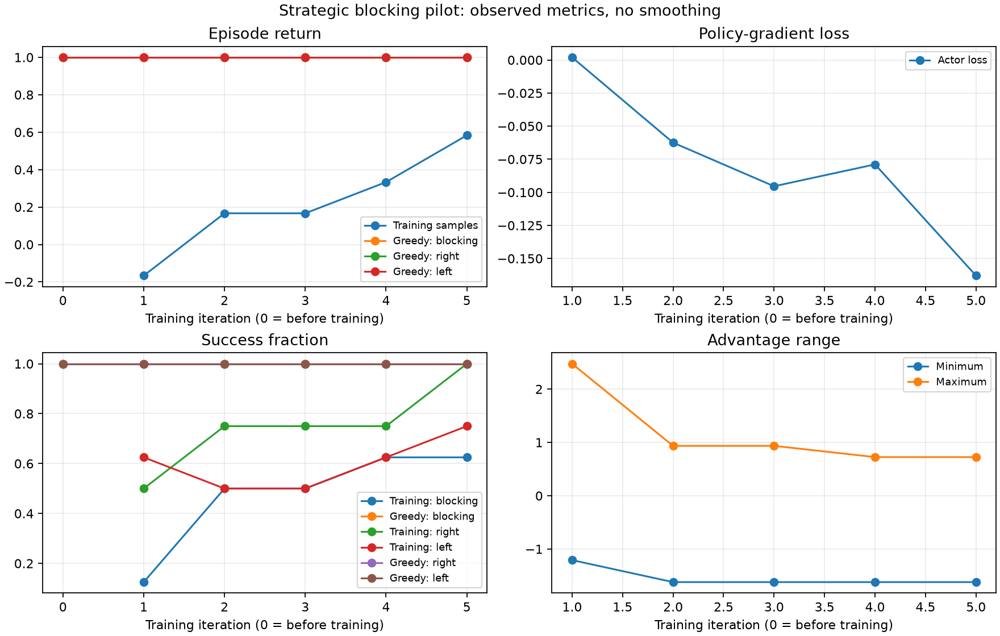

# Strategic Blocking RL pilot: verified local results

**Team:** YC Qiu and Prakeerth Prasad

**Historical milestone:** This document preserves the local evaluation before
Colab v2, Bandit, and the explanation diagnostic. Pending-work statements below
refer to that earlier stage. See [current submission status](submission-status.md),
[Colab results](colab-v2-results.md), [Bandit results](bandit-results.md), and
[explanation results](rationale-diagnostic-results.md) for subsequent evidence.

**Scope:** One sequential training chain, fixed development maps, one final
evaluation seed. Prospective transfer tests and Colab GPU execution are pending.

## Main finding

After five additional updates of mixed blocking/navigation GRPO training, the
exported Qwen2.5-0.5B-Instruct LoRA adapter won 46/50 episodes on the short
blocking fixture, compared with 10/50 for its starting adapter and 1/50 for the
original base. Navigation scores also improved in this evaluation sample.
Removing the first block from each of the 46 winning action sequences changed
every outcome to a loss, with later recorded actions held fixed.

This establishes a strong improvement on the inspected training fixture and
shows that blocking contributes functionally to the successful trajectories.
It does not establish general strategic reasoning, hidden deliberation or
performance on a population of unseen maps.

## Environment and learning setup

A and B race to different goals in a grid maze. B moves first each round using
fixed BFS shortest paths with up/right/down/left tie-breaking. A may move, wait,
or place one permanent obstacle next to itself, provided both goals remain
reachable. Runners can share cells. Rewards are +1 for A winning, -1 for B
winning, and 0 for timeout; there is no intermediate shaping reward.

The local stack uses RAGEN, veRL, Ray, vLLM and single-GPU FSDP. The policy is
Qwen2.5-0.5B-Instruct with rank-8, alpha-16 LoRA, trained with GRPO. Action-only
prompts request one legal string inside `<answer>...</answer>`. No explicit
reasoning text is requested or available for interpretation.

The final mixed stage samples three separate groups per update: eight blocking,
eight two-step-right and eight two-step-left episodes. It uses learning rate
2e-5 and zero entropy coefficient. Five updates consumed 120 sampled training
episodes. The adapter was initialized from the completed two-step stage with a
fresh optimizer; this is not an exact optimizer-state resume or a training-seed
replication. Earlier balanced and two-step stages each used 80 episodes, so this
final curriculum chain used 280 training episodes, excluding discarded pilots.

## Training evidence

Source run: `train-blocking-N6WUl30K`. The first collected actor weights matched
the supplied `train-two-step-sFYit8xQ` adapter. All five updates had some nonzero
advantages. Step 5 and the adapter were saved, and no early stop was recorded.

| Training iteration | Blocking samples | Two-step right samples | Two-step left samples |
|---|---:|---:|---:|
| 1 | 1/8 | 4/8 | 5/8 |
| 2 | 4/8 | 6/8 | 4/8 |
| 3 | 4/8 | 6/8 | 4/8 |
| 4 | 5/8 | 6/8 | 5/8 |
| 5 | 5/8 | 8/8 | 6/8 |

Training samples precede each update. Loss is the recorded policy-gradient
objective, not supervised prediction error, and need not decrease monotonically.
Every greedy validation map already succeeded at iteration 0; these single-episode
checks do not demonstrate the added value of training. The sampled evaluation
below is the main performance evidence.

## Matched sampled evaluation

The source adapter was evaluated in `paired-eval-fsx8vobm`; the final adapter in
`paired-eval-trum2mve`. Both used seed 20261111, `sha256-v2`, temperature 1.0,
top-p 1.0, top-k -1, and 50 episodes per fixed map. All 250 initial prompts,
request seeds and scheme identifiers matched between adapter evaluations.
The repeated base trajectories were byte-identical. They are one repeated
baseline, not two independent baseline experiments.

| Fixed map | Original base | Before blocking stage | After blocking stage | Change from before |
|---|---:|---:|---:|---:|
| Two-step right | 6/50 (12%) | 25/50 (50%) | 43/50 (86%) | +36 pp |
| Two-step left | 0/50 (0%) | 29/50 (58%) | 44/50 (88%) | +30 pp |
| Short blocking | 1/50 (2%) | 10/50 (20%) | 46/50 (92%) | +72 pp |
| One-step right | 13/50 (26%) | 39/50 (78%) | 46/50 (92%) | +14 pp |
| One-step left | 3/50 (6%) | 28/50 (56%) | 45/50 (90%) | +34 pp |

The final blocking success Wilson 95% interval is 81.2%-96.8%. This interval
describes sampling uncertainty for this fixed policy/map; it does not quantify
training-seed variation or generalization uncertainty. Per-policy intervals and
the full recorded training metrics are preserved in
[final-pilot-results.json](final-pilot-results.json).

Parsed illegal actions fell from 37/680 (5.4%) before training to 14/709 (2.0%)
afterward. These denominators count environment actions, not episodes. Manager
format rejections are a separate category. Each repeated base evaluation had
one such rejection: no environment action was executed and the state stayed
unchanged. The audit now verifies and records that case explicitly.

Both policies use the same cached original base. Adapter tensors match their
source checkpoint exports. Small audited frozen-base FP32 differences mean this
is exported-adapter deployment evaluation, not exact full-checkpoint replay.

## Case study and counterfactual

Open [the interactive paired replay](blocking-case.html) in a browser. It works
offline and provides Play, Previous/Next, Reset and a timeline slider.

The selected case is episode 100, the first successful blocking episode in the
final evaluation. Its executed actions are:

`move up -> block right -> move down -> move down -> move right -> move right -> move right`

A first moves into B's corridor, blocks the next corridor cell, then returns to
the lower route to its own goal. The actual race ends with A winning. In the
paired replay, the first block is replaced by `wait`, later actions are held
fixed, and B wins before A can finish. The intervention is open-loop: the model
is not asked to respond to the changed observations. Any now-illegal later
action executes `wait`, following the environment adapter rule.

All 46 final-adapter blocking wins passed the same intervention check; the
10 starting-adapter wins did as well. The base also produced a blocking win,
so useful blocking is not exclusive to RL. The evidence is that successful
behavior becomes much more frequent on the trained fixture.

All 1,000 recorded episodes across the two evaluations were replayed. See
[the audit](final-trajectory-audit.json) and [the selected replay data](blocking-case-data.json).
The visual example illustrates behavior, not an inferred chain of thought.

## Interpretation and limitations

- The result is a before/after association in one training chain, without a
  compute-matched continuation control. It does not isolate the unique effect
  of the curriculum composition from additional training and data.
- Blocking is now a training map. Its 92% result is not a held-out transfer score.
- Earlier two-step evaluations showed substantial sampling-run variation.
  Adjacent legacy seeds also reused some cross-turn request seeds; those
  historical batches are not independent replications. The final comparison
  uses the corrected versioned seed protocol.
- Deterministic single-episode validation is a smoke check, not a reliable
  success estimate. Stable training execution is separate from learned behavior.
- There are no repeated independent training seeds, broad map benchmark,
  explicit reasoning traces or completed Colab evaluation yet.

## Course requirements and remaining work

| Requirement or opportunity | Current evidence | Remaining work |
|---|---|---|
| Framework runs | Verified local LoRA/GRPO training and checkpoint evaluation | Reproducible clean installation remains to be demonstrated |
| Loss and reward curves | Recorded training curves and metrics | Include selected figures in the final submission |
| Case study | Actual trajectory plus first-block intervention | Explain the absence of explicit thinking text |
| Custom environment bonus | Maze race integrated into RAGEN, with tests | Present integration and rule validation clearly |
| Baseline improvement bonus | Matched fixed-fixture base/before/after comparison | Independent repeats and unseen-map evidence |
| Interesting findings bonus | Curriculum effects, LoRA sync repair, seed protocol issue | Distinguish observation from causal explanation |
| More environments/baselines bonus | Fixed BFS opponent and scripted rule baselines | Additional established RL environments are not completed |
| Report and presentation | This evidence pack and interactive case | Assemble submission and final-project proposal slides |

Bonus points are subject to instructor assessment. No score is guaranteed.

The next experiment is [the frozen prospective transfer suite](frozen-transfer-plan.md).
It is prepared but has no LLM results yet. The teammate can use
[the Colab handoff](colab-transfer.md) without repeating local RL training.
