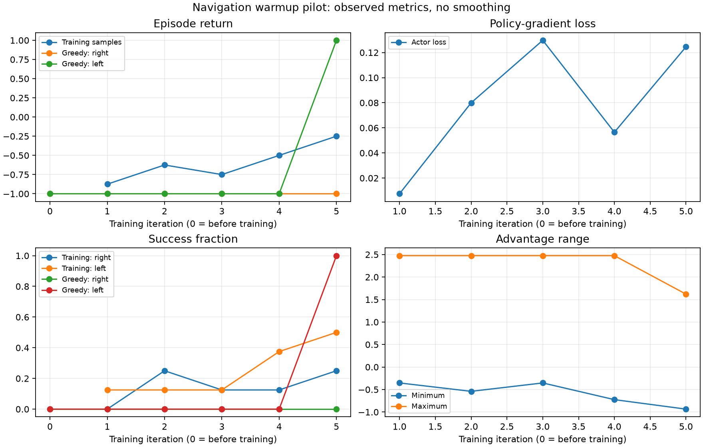

# Two-step navigation and initial blocking behavior

## Training and checkpoint provenance

`train-two-step-sFYit8xQ` starts from the verified balanced pilot adapter
(`train-balanced-jVnNYJRu`, step 5), using a fresh optimizer. The first collected
actor weights matched the supplied adapter exactly. Qwen2.5-0.5B-Instruct was
trained with rank-8 LoRA and GRPO for five updates, with eight episodes from each
of two fixed two-step navigation maps per update (80 training episodes total).
The learning rate was 2e-5, with no entropy bonus or reward shaping.

All five updates had nonzero advantages somewhere in the batch; this does not
mean every layout group had a useful reward contrast in every update. The run
triggered early stopping because right-map greedy validation failed for five
consecutive updates. Step 5 and its 336-tensor adapter were saved. The progress
bar stopped at 80%; five recorded updates do not imply normal trainer completion.
One greedy episode per one-step map succeeded at every validation checkpoint.
These small checks are not estimates of population success rates.



The curves are copied from the original run without smoothing. Right/left labels
refer to the two-step maps; one-step retention is recorded separately in the
metrics. Training episodes precede each update, whereas validation follows it.
Policy-gradient loss need not decrease monotonically and is not evidence of
learning by itself.

## Sampled evaluation

Each entry below represents 50 episodes per policy and fixed map. Temperature
was 1.0, top-p 1.0 and top-k -1. The adapter SHA256 was identical in both runs:
`1801c9752b5b17f2b6518b58f242227e71ec149d0d30d0a19e842dc2eb2f9908`.
The base revision, source hashes, dependencies and configuration also matched;
only the evaluation seed changed.

| Layout | Base, seed 20261109 | Adapter, seed 20261109 | Base, seed 20261110 | Adapter, seed 20261110 | Descriptive totals: base / adapter |
|---|---:|---:|---:|---:|---:|
| Two-step right | 5/50 | 32/50 | 4/50 | 13/50 | 9/100 / 45/100 |
| Two-step left | 1/50 | 35/50 | 0/50 | 29/50 | 1/100 / 64/100 |
| Short blocking | 0/50 | 9/50 | 1/50 | 9/50 | 1/100 / 18/100 |
| One-step right | 15/50 | 49/50 | 9/50 | 44/50 | 24/100 / 93/100 |
| One-step left | 4/50 | 29/50 | 7/50 | 32/50 | 11/100 / 61/100 |

Source runs: `paired-eval-5h31j7y2` and `paired-eval-4erqylii`. All 1,000
trajectories were replayed successfully against the deterministic environment.
Per-run Wilson intervals and training metrics are in
[two-step-pilot-results.json](two-step-pilot-results.json).

The old request seed formula was `seed + env_id * 1000 + turn`. Adjacent
experiment seeds reuse cross-turn seeds: these two runs share 325 adapter
request seed values and 386 base request seed values. This does not invalidate
the observed outcomes, but the runs are not independent replications. Their
totals are descriptive; no pooled independence-based interval is claimed.
New evaluations use the versioned SHA256 scheme described in
[CHECKPOINT_EVALUATION.md](../CHECKPOINT_EVALUATION.md).

The earlier balanced adapter scored 9/50 on each two-step map and 1/50 on
blocking under the first run's initial prompts and seeds. Continued training
improved those fixed-fixture scores, but uses additional data and compute. It
is not a controlled demonstration that this curriculum is uniquely effective.
Blocking was not a training layout in the two-step stage, but it was already a
repeatedly inspected development fixture, not a held-out benchmark.

## Failure analysis

The two-step right success rate changed from 64% to 26%. Correct first moves
changed from 40/50 to 35/50, while immediate `right -> right` completions fell
from 26/50 to 9/50. Returning left after the first right move is a common failure.
The observations locate the failure at multi-turn action selection; they do not
by themselves identify whether sampling, batching, numerical effects or other
inference behavior caused the difference. No additional training occurred
between these evaluations.

## Case study: a useful blocking detour

Adapter episode 113 in `paired-eval-5h31j7y2` moves toward the opponent's corridor,
blocks it, then returns to the route to A's goal. Coordinates are zero-based
(row, column). B moves first; the table records positions immediately after A's
action, before the next B move.

| Round | A action | A position after action | B position | Obstacle | Outcome |
|---|---|---|---|---|---|
| 1 | `move up` | `(1, 3)` | `(1, 2)` | `None` | In progress |
| 2 | `block right` | `(1, 3)` | `(1, 3)` | `(1, 4)` | In progress |
| 3 | `move down` | `(2, 3)` | `(2, 3)` | `(1, 4)` | In progress |
| 4 | `move down` | `(3, 3)` | `(3, 3)` | `(1, 4)` | In progress |
| 5 | `move right` | `(3, 4)` | `(3, 4)` | `(1, 4)` | In progress |
| 6 | `move right` | `(3, 5)` | `(3, 5)` | `(1, 4)` | In progress |
| 7 | `move right` | `(3, 6)` | `(3, 6)` | `(1, 4)` | A |

Replacing the first block with `wait`, holding the remaining action list fixed,
changes this episode from an A win to a B win. Across both evaluations, all
18 successful adapter blocking trajectories also lose under this intervention.
Any subsequent illegal action is executed as `wait`, matching adapter behavior;
replay stops as soon as either runner wins. This is an open-loop intervention,
not a fresh rollout of the policy under a changed observation.

This supports the functional importance of blocking in these trajectories. It
does not reveal the model's intention or internal reasoning. The action-only
protocol records no explicit thinking text. The base also produced one blocking
win in the second batch; useful blocking behavior is not exclusive to RL.

The [trajectory audit](two-step-trajectory-audit.json) contains all successful
blocking action lists, counterfactual outcomes and source file hashes. Reproduce
an audit without model inference:

```bash
python scripts/audit_pilot_evaluation.py results/paired-eval-5h31j7y2 \
  --output results/paired-eval-5h31j7y2/replay-audit.json
```

The output must not already exist. No checkpoint is modified.

## What this establishes for the course project

- Framework execution: LoRA/GRPO training, checkpoint verification and evaluation run.
- Curves: policy-gradient loss, episode return, success and advantage range are recorded.
- Case study: actual blocking detours and counterfactual replay are available, without invented reasoning text.
- Candidate bonus evidence: a custom environment, fixed-fixture baseline improvement,
  curriculum observations, and a reproducibility issue in evaluation seed allocation.
- Still incomplete: independent training repeats, held-out maps, broader baselines,
  and confirmation of the teammate's Colab experiments. No bonus score is guaranteed.

Next: [mixed blocking curriculum](blocking-curriculum.md).
